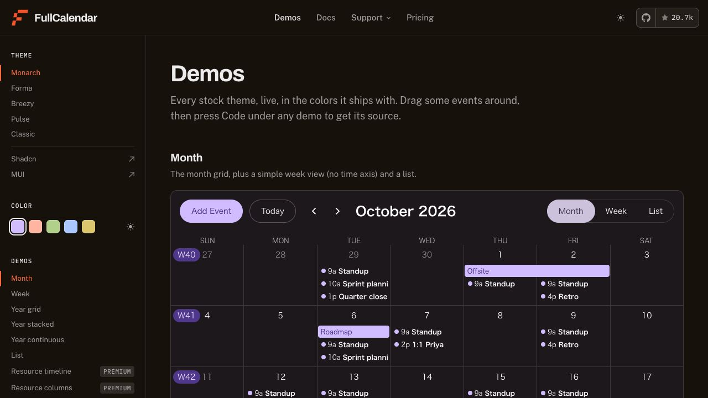
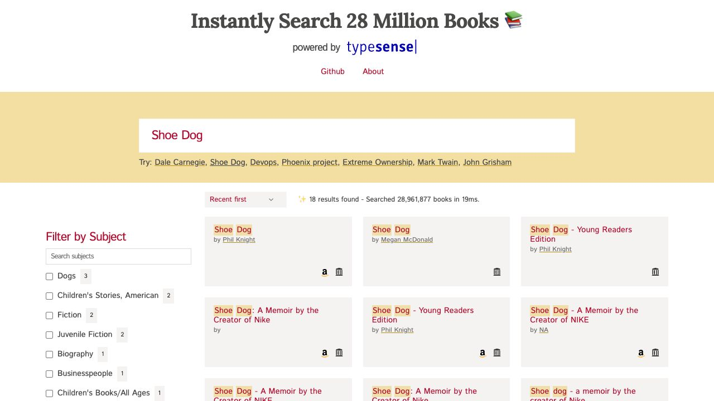
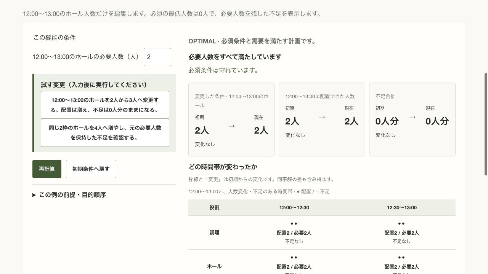
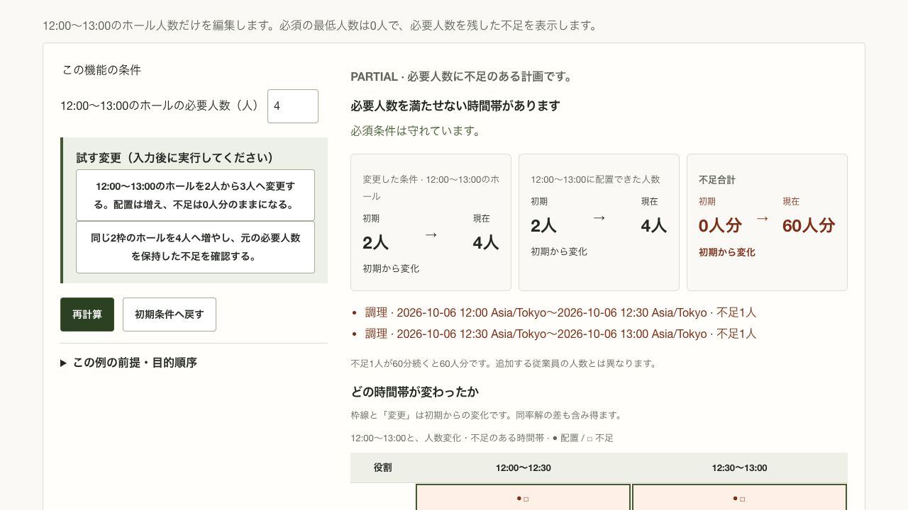
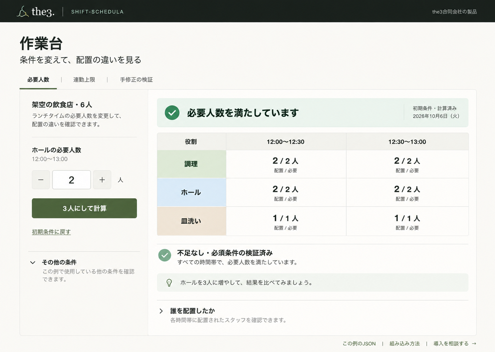
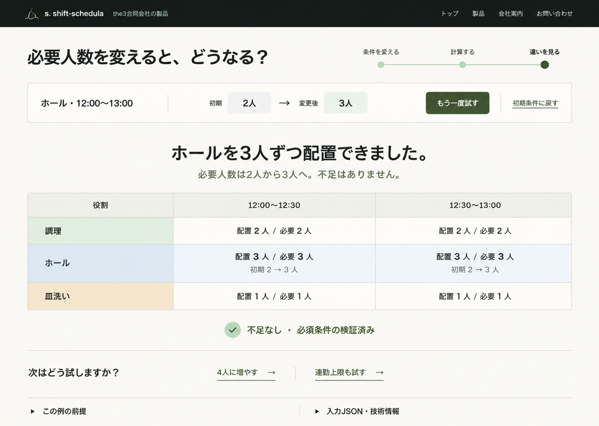
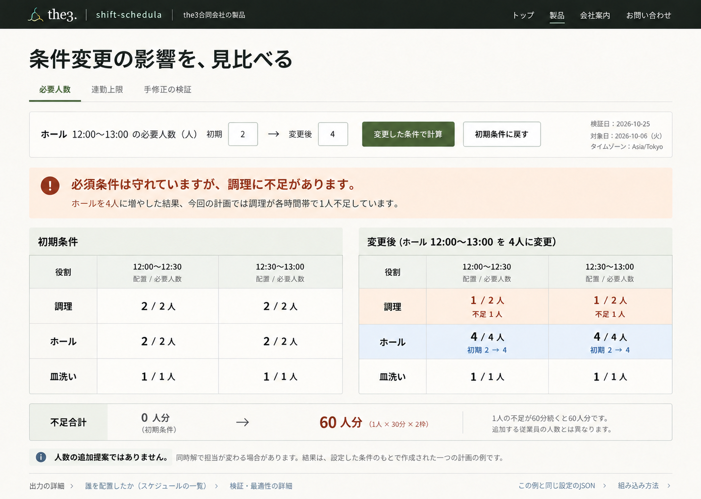

# 「試しに使う」デモの調査と改善設計

確認日: 2026-10-25（日本時間）。対象は公開中の shift-schedula 製品紹介・デモ。
本書は改善方針を検討するための提案であり、公開画面や教材の動作を変更したものではない。
後続のローカル実装と画面確認は[実装・画面確認の記録](../../design-qa.md)を参照する。
[既存の教材仕様](demo-redesign.md)と[製品Webの基準](../web-design.md)を前提とする。

## 提案

**最初の画面を、説明と機能一覧から「条件を一つ変え、配置の変化を見られる作業台」へ変える。**
既存の緑と明るい背景は活かせる。優先するのは、操作に到達するまでの長さ、操作と結果の距離、
結果の読み取り方の改善。会社サイトの深い緑を小さな共通領域へ取り入れ、データを見る部分は明るく保つ。

読み手は製品担当者・設計者・実装者。読み終えたら、代表教材の画面構造と配色の役割を選べることを目指す。
中心の問いは「初めて来た人が、説明を読み込まずに一回試し、何が変わったか説明できるか」。
初回利用者には勤務作成の業務担当者を仮定し、技術者には同じ例のJSON・技術案内への出口を用意する。
実際の利用者調査でこの仮定を検証する。

## 参考サイトと取り入れる理由

8サイトの一次情報・確認範囲は[参考サイト調査](demo-reference-research.md)に記録した。
加えて今回は Typesense Books の画面を実操作した。各社の成果やコンバージョン改善率を示す調査ではない。

| 参考先 | 今回の確認方法 | schedula に使える原則 |
| --- | --- | --- |
| [FullCalendar](https://fullcalendar.io/demos) | 実画面と月表示→List表示の切替を確認 | 最初からデータ入りの結果を見せ、体験の後に同じ例の `Code` へ進める |
| [Typesense Books](https://books-search.typesense.org/) | `Shoe Dog` の候補をクリックし、入力と18件の結果表示を確認 | 「何を入力すればいいか」を短い実行例で示し、一操作で結果へ進める |
| [AG Grid Inventory](https://www.ag-grid.com/example-inventory/) | 公式ページ・説明を確認。操作は未確認 | 業務を想像できる架空データを見せ、ソース・相談へつなぐ |
| [Algolia E-commerce](https://instantsearchjs.netlify.app/examples/js/e-commerce/) | 公式紹介・取得本文。操作は未確認 | 条件と結果を近接させて、同じ場所で往復できるようにする |
| [Typesense E-commerce](https://ecommerce-store.typesense.org/) | 公式一覧・取得本文。操作は未確認 | エンジンの機能名を、業務に近い操作へ翻訳する |
| [Desmos](https://www.desmos.com/calculator) | 公式ヘルプ。操作は未確認 | 一条件と観察する変化を対応させる。連続操作ごとの求解は模倣しない |
| [regex101](https://regex101.com/) | 現行の入力・説明・詳細の配置を画面確認。入力実行は未確認 | 入力と結果説明を同じ視野へ置く。多数の専門機能は初回には持ち込まない |
| [Mermaid Live](https://mermaid.live/) | 公式ガイド。操作は未確認 | 動くサンプルを渡し、人が読む結果から入力の取り出しへ進める |
| [Mapbox Playground](https://docs.mapbox.com/playground/geocoding/) | 公開本文の例・Reset・Request/Responseを確認。API実行は未確認 | 例・復元・技術情報の置き場所を明確にする。token入力の障壁は移さない |

FullCalendar は表示部品のデモであり、勤務の最適化・独立検証の実証ではない。
Typesense の検索応答を schedula の計算速度の根拠にはしない。
参考にするのは「触る→分かる→詳しく見る」という体験の構造である。

## 現行画面を操作して分かったこと

確認した公開先は[製品紹介](https://the3.co.jp/products/schedula/)と
[公開デモ](https://the3.co.jp/products/schedula/demo/)。デスクトップの取得画面は1280×720。
ローカルのコードに存在する教材と、公開されている教材は区別した。
公開フッターは「必要人数・連勤・手修正検証の3教材」と案内していた。

| 手順 | 操作と確認結果 | 状態の評価 | 証拠 |
| --- | --- | --- | --- |
| 1 | 製品紹介を開く。深緑の背景、ミントのリンク、同系の書体を確認 | ブランドの基準になる。ファーストビューの主導線は相談 | [画面](demo-usability/assets/00-product-home.png) |
| 2 | デモの通常入口を開く。説明と分類が先に表示される | 初回の操作・結果が見えない。選択前の負担がある | [画面](demo-usability/assets/01-demo-entry.png) |
| 3 | 必要人数へ移動。初期計算は成功し、ホール2人・不足0を表示 | 初期結果があるのはよい。大きな共通見出しが操作を下へ押す | [操作部](demo-usability/assets/03-demand-controls.png) |
| 4 | 「2人から3人」のガイドを押す。入力だけ変わり、再計算を押すと配置3人・不足0 | 編集と計算を区別できる。一方、初回のおすすめ操作が2段階 | [結果](demo-usability/assets/04-demand-three.png) |
| 5 | 4人へ変更し再計算。ホール4人、調理の2枠で各1人不足、合計60人分 | 不足を隠さず返せる。操作対象とは別の役割への影響を見せたい | [結果](demo-usability/assets/05-demand-shortage.png) |
| 6 | 初期条件へ戻す。入力2人・配置2人・不足0・差分0へ戻った | やり直しが成立している。この操作を分かりやすく残す | [復元](demo-usability/assets/06-demand-reset.png) |
| 7 | 連勤教材を開き、上限・履歴・勤務可能日と初期結果の構成を確認 | 条件と実績の区別はある。最初の一操作に対する情報量が多い | [入口](demo-usability/assets/07-consecutive-days.png) |
| 8 | 手修正教材を開き、Bobへ変更して再検証。`INVALID_PLAN` と二重配置を確認 | 間違いを検出できる。技術用語と同文の診断が前面に重複する | [初期](demo-usability/assets/08-verify-initial.png)・[検証後](demo-usability/assets/09-verify-conflict.png) |

### 先に直したい問題

1. **触る前の画面が長い。** 通常入口の上部約440pxは見出し・説明・移動・注意書き。
   個別教材へ直接入っても、同じ共通領域が残る。デモ用の短い見出しと選択部に圧縮する。
2. **選択肢の分類が、今試せる量に合っていない。** 公開画面には教材リンクのない分類見出しもある。
   初回は3つの代表体験を提示し、網羅的な機能表は別の探索導線へ移す。
3. **長い文章がボタンになっている。** 操作名・手順・期待結果が一つに詰まっている。
   操作は「3人で試す」、補助説明は「人数を増やしたときの変化を見ます」のように分ける。
4. **初期状態から比較カードが並ぶ。** 2→2、2→2、0→0が同じ強さで表示される。
   初期は配置表と短い状態、操作後は変更と影響を示す。一律の指標カードを減らす。
5. **結果の読み取りが説明より後になる。** 手修正画面では最適性・不足最小性・priority・JSON位置が
   編集案の表より先に並ぶ。まず「Bobが同じ時間に2つの役割を担当しています」と対象箇所を示す。
   根拠のコード・pointer・証明範囲は消さず、詳細へまとめる。
6. **警告より変更枠が目立つ。** 不足時も緑の変更枠と茶色の文字が混在する。
   変更を示す細い輪郭と、不足を示す背景・ラベルを分ける。

観察と解釈を分ける。今回の4人条件では調理に不足が出たが、すべての実行で同じ人選・役割への
割当になると保証しない。説明は、その実行の Response にある不足・割当から組み立てる。
同率解の差をすべて操作の必然的な影響と説明しない。

## すすめる体験と画面の構造

### 入口から結果理解まで

1. 製品紹介の最初の画面に「デモを試す」を置き、相談は補助導線にする。
   現行の3教材への直接リンクも維持する。
2. デモの通常入口は「必要人数」を開く。機能一覧で選ばせる操作を挟まない。
   「必要人数」「連勤上限」「手修正の検証」を短い選択部に置く。
3. 「架空の6人・2026-10-06・Asia/Tokyo」を示し、初期計算を開始する。
   初期結果は実際の計算結果。キャッシュを使う場合は入力と結果の版を一致させ、出所を示す。
4. 初回の主操作は「3人で試す」。対象の人数を3へ変更して計算まで行う。
   手入力した場合の主操作は「変更した条件で計算」とし、値とボタンの意味を一致させる。
   ガイド操作をしただけで計測を成功扱いせず、結果の受領・有効性を確かめる。
5. 「ホールの必要人数 2→3人」「配置2→3人」「不足なし」と、対応する表の変化を同じ領域に示す。
   初期との比較であることを明記する。前回との比較へ勝手に切り替えない。
6. 次の試し方として「4人に増やす」を示す。不足が出たら役割・時間・人数を表の中に表示する。
7. 「初期条件に戻す」を常設する。入力全体と初期比較元を復元し、古い計算応答が復元後を上書きしない。
8. 結果の下で「この例のJSON」「組み込み方法」「自社条件を相談する」を選べるようにする。
   デモから、本番用の人員・資格・需要を自動補完する機能へはつなげない。

### デスクトップの配置

| 領域 | 設計 |
| --- | --- |
| 共通ヘッダー | 高さ64〜72pxを目安に、製品名・会社との関係・紹介へ戻る・技術案内。大きなヒーローを置かない |
| 教材選択 | 短い見出しと3教材。URLの既存 `#demand` / `#consecutive_days` / `#verify` を維持 |
| 左の操作部 | 幅280〜320px程度。変更する条件1つ、主操作1つ、復元。その他の条件は開閉可能 |
| 右の結果部 | 残りの幅を使用。状態の一文→主題の配置表・勤務表→変更の短い説明。初期に指標カードを並べない |
| 詳細 | 人別担当、前提、検証・最適性、JSONを必要な順に開ける。初回結果を隠さない |
| 次の行動 | 次の教材、同じ例のJSON、組み込み、相談。計算の主操作と同じ強いボタンを並べない |

1280×720で、最初の入力・計算操作・結果の要点がスクロールせず見えることを実装時に確認する。
1440×1024のモックだけでこの要件を満たしたとは判断しない。
勤務表は既存の表表示を活かす。新規のカレンダー製品やドラッグ編集機能の導入を前提にしない。

### 主題に合わせる結果の見せ方

| 教材 | 最初に見るもの | 詳細へ移すもの |
| --- | --- | --- |
| 必要人数 | 役割×時間の「配置 / 必要」と不足。変えた役割以外も残す | 人別の全割当、全セルの差分、JSON |
| 連勤上限 | 人×日の勤務表と実際の最大連勤。設定上限と実績を別に表示 | 履歴の全項目、目的順序、詳細な評価値 |
| 手修正の検証 | 編集対象の担当表、違反位置、人・時間・役割による説明、直し方 | 診断コード・JSON pointer、最適性などの証明範囲 |

`PARTIAL` は「計算エラー」と表示しない。「条件は守れていますが、必要人数に不足があります」とする。
`UNKNOWN` は「時間内に結果を確定できませんでした」とし、不可能性の証明に読み替えない。
検証の `VALID` は最適性の認定と分ける。説明を短くしても、条件・需要・最適性の区別は残す。
技術用語を理解しないと結果を読めない順序を避ける。

### 編集・待機・失敗・復元の扱い

| 状態 | 画面のルール |
| --- | --- |
| 初期読み込み | 対象教材の名前と読み込み中表示を出す。前の教材の条件を新しい見出しの下へ残さない |
| 編集後 | 「変更は未反映」。前回結果を残す場合は見出しに「前回の条件」と明示し、現在条件の結果と並べ替えない |
| 計算中 | 結果領域の大きさを安定させ、状態を通知。開始時の入力を固定し、連打による二重要求を防ぐ |
| 成功 | 計算済み条件・配置表・変更点を一緒に更新する。自動の大きなスクロールや連続アニメーションは避ける |
| 入力不備 | 項目の近くに原因と許容範囲。入力を消さず、修正箇所へ進める |
| 通信・実行失敗 | エラーと未更新を示し、そのまま再試行できる。架空の成功結果へ置き換えない |
| 初期条件に戻す | 入力・比較元・表示を整合させて復元。何が戻るかは操作のそばへ短く示す |
| 教材切替 | デモの変更がリセットされることを選択部で案内。現段階では保存機能・確認モーダルを増やさない |

### 狭い画面

設計案は一列。教材→短い操作→結果の一文→表→詳細とし、計算後は結果見出しへの移動手段を提供する。
長文ガイドを結果より先に積まない。表だけを横スクロール可能とし、ページ全体を横へ広げない。
需要教材は2時間列のまま、7日間の勤務表は見出しと従業員名の追従を検討する。
表の読み替えで値・時間・人の対応を失わない。
390px幅・200%拡大・キーボードで別途実機確認する。今回のブラウザーの幅変更要求は実際の
viewportへ反映されず、狭い画面の現状評価はできていない。

## ホームページとの関係と配色

現行製品紹介の計算済みスタイルは、背景 `#121916`、文字 `#EDF2EF`、相談リンク `#ACD8C2`。
デモの現行CSSは背景 `#FAF9F5`、本文 `#242822`、アクセント `#435B35`、フォーカス `#9C5A18`。
会社側の暗さを表全体へコピーせず、共通ヘッダーと文字・余白の基準で連続性を作る。
ロゴは製品の `s.` と wordmark を維持し、会社への関係表示を添える。

| 用途 | 提案する値 | 使用のルール |
| --- | --- | --- |
| 共通ヘッダー | `#121916` / 文字 `#EDF2EF` | 会社サイトとの接続。本文領域を圧迫しない |
| ヘッダーの補助アクセント | `#ACD8C2` | 補助リンクや小さな識別。白背景の本文色には使わない |
| 基本背景・結果面 | `#FAF9F5` / `#FFFFFF` | データは明るい面。面の違いは必要な箇所だけ |
| 本文・補助文 | `#242822` / `#62675E` | 本文16px、補助14pxを目安。重要条件は小さな注意書きへ落とさない |
| 主操作 | `#435B35` / 白文字 | 計算・検証に使う。一つの操作領域で主操作を一つに絞る |
| 区切り | `#DCDED5` | 8px刻みの余白と整列を先に使う。カードの入れ子を減らす |
| 通常の役割識別 | 調理 `#E3EEE8`、ホール `#E8EFF7`、皿洗いは中立色 `#F1F1EC` | 色は補助。役割名と人数を必ず併記。通常の役割に警告色を使わない |
| 不足 | 背景 `#FFF0E7` / 文字 `#802D17` | 「不足1人」などのテキストと併用。必須条件違反とは区別 |
| 入力不備・必須条件違反 | 背景 `#FFF1EF` / 文字 `#9D3027` | 該当項目・担当セルと直し方を示す |
| 変更点 | 細い輪郭と「変更」「初期2→3」 | 役割の背景色と不足の背景色を上書きしない |
| フォーカス | `#9C5A18`、3px、外側6px | 既存基準を維持。暗いヘッダー上の視認性は別に確認 |

提案色の相対輝度を計算した結果、本文/背景14.22:1、補助文/背景5.50:1、白文字/主操作7.54:1、
ヘッダー文字/背景15.77:1、不足文字/背景8.18:1、違反文字/背景6.61:1。
[W3Cの通常文字4.5:1の基準](https://www.w3.org/WAI/WCAG22/Understanding/contrast-minimum.html)を
これらの組合せは満たすが、実装・生成画像全体の適合を保証するものではない。
境界線、hover、disabled、選択状態、実際の文字サイズ、キーボード・読み上げは別途確認する。

## 画面案の使い分け

3枚はレイアウトを比較するための生成画像。文字、ロゴ、厳密な数値・色は本書の仕様を正とする。
実装済み・操作可能・アクセシビリティ検証済みの画面ではない。

| 方向 | 主な構造 | 向く場面 | 注意点 |
| --- | --- | --- | --- |
| 作業台 | 左に条件、右に結果を常設 | 数値を変えながら何回か確かめる。今回の推奨 | 初回の誘導を短い一文とおすすめ操作で補う |
| はじめての一周 | 操作帯→大きい結果→次に試す問い | 非技術者の最初の一回 | 複数の条件を掘り下げる操作への接続が弱くなりやすい |
| 変更前後の比較 | 初期と現在を同じ基準で対比 | 不足や役割間の影響を説明する | 狭い画面では横並びを維持しない。比較を第三の独立モードへ増やさない |

推奨は作業台を基本に、はじめての一周の短い誘導と、比較案の変更ラベルを組み合わせること。
全体の色を変える案を3種類作るのではなく、同じブランドで情報の順序を比較する。

### 作業台

生成画像の「作業台」は検討名。実際の画面見出しには「条件を変えて、配置の違いを見る」を使う。
ヘッダーには既存の製品ロゴを使い、生成された会社ロゴへの置換は行わない。

### はじめての一周

### 変更前後の比較

## 実装範囲と確認方法

この提案を採用する場合の変更対象は以下。今回の成果物は調査・設計まで。

| 責任 | 対象と確認内容 |
| --- | --- |
| デモの構造・見た目 | `demo/index.html`、`demo/style.css`、必要な範囲の `demo/landing.css`。共通CSS変更は技術案内にも影響するため確認 |
| 入口・状態・結果 | `demo/features.js`、`demo/feature-state.js`、`demo/verify-demo.js`。既存の計算・状態管理・検証結果を再利用 |
| 会社側の紹介 | 別リポジトリ landing-page の製品紹介。デモCTAの位置と共通ヘッダーの色を両側で確認 |
| 教材・契約 | 既存の `catalog.json`・`lessons.json`・Request/Responseを維持。架空の日付・資格・需要をUI都合で補わない |
| 公開経路・ブラウザー確認 | `tests/public-browser.cjs`、`tests/test_public_demo.py`と公開ビルド。3教材の直接リンク、復元、古い結果、読み込み・失敗、会社への戻り先を確認 |
| 計測 | 既存 `demo_run_success` の意味を維持。初期自動計算やボタン押下だけを成功にしない。入力・人名・JSONを送らない |

実装後の利用者評価は、業務担当者を含む5人程度の小さな観察から始める。
以下は合格基準の案であり、現時点で達成した値ではない。

- 5人中4人が、説明役なしで最初の条件変更と計算を完了できる。
- 5人中4人が「変えた条件」「配置の変化」「不足の有無」を自分の言葉で説明できる。
- 4人条件で調理に不足が出た結果を見せ、ホールだけ見て「すべて充足した」と誤認しないか確認する。
- 全員が初期状態へ戻れ、未反映・計算中・前回結果を現在の計画と取り違えない。
- 1280×720の初期画面に最初の操作と結果要点が入り、390pxではページ全体が横に溢れない。
- マウス・キーボードで一周でき、状態通知とフォーカスが分かる。色を除いても変更・不足・違反を区別できる。

初回の意味理解を先に観察する。クリック数や滞在時間だけで使いやすさを判定しない。
応答時間、実機のモバイル、読み上げ、問い合わせ受付、アクセス解析の受信は今回未検証。
